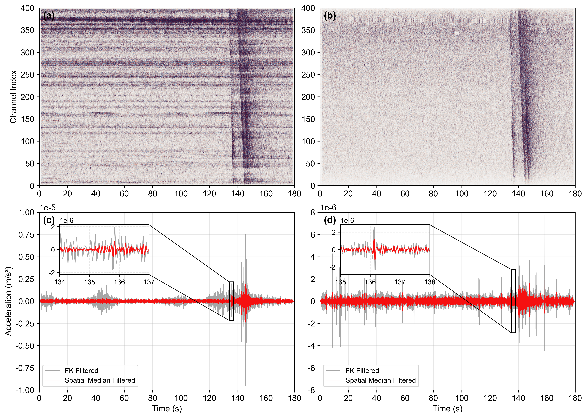

# DAS Spatial Median Filter

Spatial median filtering code for “Automatic Offshore Earthquake Detection and Hierarchical Bayesian Source Location Using Seafloor Distributed Acoustic Sensing: Insights From a Wind-Farm Cable Survey Near the Littoral Fault Zone, Northern South China Sea”.

This repository contains the spatial-median denoising implementation and a small Figure 2 test dataset. The included HDF5 files are the processed FK-filtered input and its spatial-median-filtered reference output.

## Figure 2 before/after comparison

The figure below shows the FK-filtered input and spatial-median-filtered result together, including the array panels and two trace comparisons.



## Install

```bash
python -m pip install -r requirements.txt
```

## Run the Figure 2 regression test

```bash
python -m unittest discover -s tests -v
```

The test reads `tests/data/fig2_fk_filtered.h5`, applies the filter with the Figure 2 settings (`n_samples_stft=128`, `n_aperture_channels=50`, and `threshold_multiplier=0.8`), and compares the result with `tests/data/fig2_spatial_median_reference.h5`. It checks that both files load correctly and that the reproduced waveform agrees numerically with the reference.

GitHub Actions runs the same test on each push and pull request.

## Use the command-line interface

```bash
python spatial_median_denoiser.py INPUT.h5 OUTPUT.h5 --aperture 50 --threshold 0.8
```

The filter accepts channel-by-time DAS arrays. The HDF5 interface reads and writes `Acquisition/Raw[0]/RawData`; see `spatial_median_denoiser.py` for implementation details.

The included test files are processed Figure 2 data intended only to validate the filter.
